  

  
  

## 👋 About me

I'm a student developer at **Chitkara University** 🎓 who loves turning ideas into impactful projects 🚀. I'm always learning something new, and I'm always up for a tech challenge.

**💻 What I work with**

- 🐍 **Python**: automation, scripting and machine learning
- ⚡ **JavaScript**: web development with React
- 🖥️ **C++**: systems programming and competitive coding

**🔭 What I'm focused on**

- ⚙️ Building projects in Python, JavaScript and C++
- 🌐 Exploring web development and open-source contributions
- 🤖 Learning machine learning and new technologies

🤝 **Let's collaborate!** Got a cool project idea? I'd love to brainstorm, and I'm open to working on open-source projects and real-world challenges.

## 🛠️ Tech stack

  <b>LANGUAGES</b> 
  <picture>
    <source media="(prefers-color-scheme: dark)" srcset="https://skillicons.dev/icons?i=py,js,ts,cpp,c,php,html,css,powershell&theme=dark" />
    <source media="(prefers-color-scheme: light)" srcset="https://skillicons.dev/icons?i=py,js,ts,cpp,c,php,html,css,powershell&theme=light" />
    
  </picture>

  <b>FRAMEWORKS &amp; LIBRARIES</b> 
  <picture>
    <source media="(prefers-color-scheme: dark)" srcset="https://skillicons.dev/icons?i=react,django,flask,tailwind,bootstrap,tensorflow,wordpress&theme=dark" />
    <source media="(prefers-color-scheme: light)" srcset="https://skillicons.dev/icons?i=react,django,flask,tailwind,bootstrap,tensorflow,wordpress&theme=light" />
    
  </picture> 
  + React Native · pandas · NumPy

  <b>CLOUD &amp; DATABASES</b> 
  <picture>
    <source media="(prefers-color-scheme: dark)" srcset="https://skillicons.dev/icons?i=aws,azure,gcp,firebase,cloudflare,vercel,netlify,mongodb&theme=dark" />
    <source media="(prefers-color-scheme: light)" srcset="https://skillicons.dev/icons?i=aws,azure,gcp,firebase,cloudflare,vercel,netlify,mongodb&theme=light" />
    
  </picture> 
  + DigitalOcean · Linode · Oracle · GitHub Pages

  <b>TOOLS &amp; HARDWARE</b> 
  <picture>
    <source media="(prefers-color-scheme: dark)" srcset="https://skillicons.dev/icons?i=github,notion,arduino,raspberrypi&theme=dark" />
    <source media="(prefers-color-scheme: light)" srcset="https://skillicons.dev/icons?i=github,notion,arduino,raspberrypi&theme=light" />
    
  </picture> 
  + Canva · Adobe · Cisco

## 📊 GitHub stats

  <picture>
    <source media="(prefers-color-scheme: dark)" srcset="profile/stats-dark.svg" />
    <source media="(prefers-color-scheme: light)" srcset="profile/stats-light.svg" />
    
  </picture>
  <picture>
    <source media="(prefers-color-scheme: dark)" srcset="https://streak-stats.demolab.com/?user=JivanshM&background=0D1117&border=30363D&stroke=30363D&ring=A78BFA&fire=FB923C&currStreakNum=E6EDF3&currStreakLabel=A78BFA&sideNums=E6EDF3&sideLabels=C9D1D9&dates=8B949E&border_radius=6" />
    <source media="(prefers-color-scheme: light)" srcset="https://streak-stats.demolab.com/?user=JivanshM&background=FFFFFF&border=D0D7DE&stroke=D0D7DE&ring=7C3AED&fire=EA580C&currStreakNum=1F2328&currStreakLabel=7C3AED&sideNums=1F2328&sideLabels=1F2328&dates=57606A&border_radius=6" />
    
  </picture>

  <picture>
    <source media="(prefers-color-scheme: dark)" srcset="profile/top-langs-dark.svg" />
    <source media="(prefers-color-scheme: light)" srcset="profile/top-langs-light.svg" />
    
  </picture>

 

   
  Thanks for stopping by! ✨

